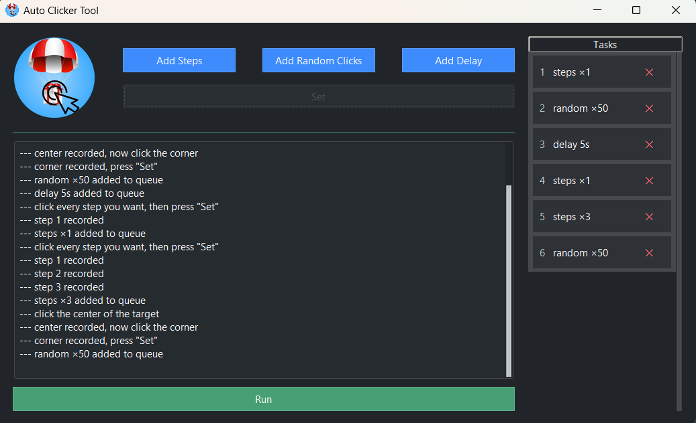

# AutoClickerBot

A desktop auto clicker for farming **tap-to-earn airdrops**. You record the clicks once, and the bot replays them for you. It can also click at a randomized spot inside the target area, so the clicks aren't pixel-identical every time.



## Features

- **Record click paths.** Click through a sequence of buttons once, and the bot replays it in the same order.
- **Randomized clicking.** Mark a target area. The bot clicks a random point inside it on every click, for a set number of clicks or a set number of seconds.
- **Delays.** Insert pauses between tasks, for example while a page loads or an energy bar refills.
- **Task queue.** Tasks are numbered and run top to bottom. Remove any task with **✕**.
- **Instant stop.** Press **Esc** at any time during a run, even in the middle of a long task.
- **Live log.** Every recorded click, finished task and error is shown in the log.
- **Ignores its own window.** Clicks on the bot's own buttons and dialogs are never recorded.

## Task types

| Button | What it records | What it does on **Run** |
| --- | --- | --- |
| **Add Steps** | Every click you make, in order | Clicks each recorded point exactly, waiting the chosen delay between clicks (default 0.5 s) |
| **Add Random Clicks** | Two clicks: the **center** of the target, then a **corner** of it | Clicks random points within the circle from the center to the corner, for N clicks or a set duration |
| **Add Delay** | Nothing | Waits the given number of seconds |

In a random-clicks task, the distance from the center to the corner is the radius. Each click picks a new random point within that radius, and each click is followed by a short pause (0.15 s by default).

## Requirements

- Windows 10 or 11. It was developed and tested on Windows 11. Other platforms are untested.
- Python 3.10 or newer.

Dependencies are installed automatically from `pyproject.toml`: [ttkbootstrap](https://github.com/israel-dryer/ttkbootstrap) 2.x for the GUI, [pynput](https://github.com/moses-palmer/pynput) for mouse and keyboard control, and [Pillow](https://python-pillow.org/).

## Installation

```powershell
git clone https://github.com/SShiravy/AutoClickerBot.git
cd AutoClickerBot
python -m venv .venv
.venv\Scripts\activate
pip install -e .
```

## Usage

Start the app with either command:

```powershell
python main.py
autoclicker
```

Then build your queue:

1. **Add Steps.** Set the delay between clicks and press **OK**. Click each spot you want, in order. The log confirms each one with `step N recorded`. Press **Set** when you're done.
2. **Add Random Clicks.** Enter the number of **Clicks**, or fill in **Or duration (s)** to click for a set time instead. If you fill in a duration, it is used instead of the click count. Press **OK**, click the **center** of the target, then one of its **corners**, then press **Set**.
3. **Add Delay.** Enter the number of seconds. The delay is added to the queue right away.
4. Press **Run**. Tasks run from top to bottom, and the current one is highlighted in blue.
5. Press **Esc** to stop at any time.

Tips:

- **Dialog keys.** In the dialogs, **Enter** means OK and **Esc** means Cancel. Invalid numbers turn red.
- **Empty recordings.** Pressing **Set** before recording anything discards the task.
- **Don't touch the mouse during a run.** Moving it can push the clicks off target.
- **Delays.** Use an **Add Delay** between tasks that need the screen to update first.

## Configuration

Default timings and appearance are in [`config.py`](config.py):

| Setting | Default | Meaning |
| --- | --- | --- |
| `CLICK_DELAY` | `0.15` | Pause in seconds after each random click |
| `STEP_DELAY` | `0.5` | Default delay between clicks in the **Add Steps** dialog |
| `DEFAULT_DELAY` | `5.0` | Default value in the **Add Delay** dialog |
| `DEFAULT_RANDOM_CLICKS` | `50` | Default click count in the **Add Random Clicks** dialog |
| `THEME` | `"bootstrap-dark"` | Any ttkbootstrap 2 theme, such as `bootstrap-light`, `nord-dark` or `dracula-dark` |

## Project structure

```
main.py              entry point
controller.py        connects the GUI to the tasks and runs the queue in the background
config.py            timings, theme and window settings
GUI/
  main_window.py     main window, task list and log
  dialogs.py         input dialogs with validation
  assets/            app icon and logo
Models/
  base.py            task base classes: click recording and replay
  path_clicks.py     Add Steps task
  random_clicks.py   Add Random Clicks task
  delay.py           Add Delay task
```

## Roadmap

- Repeat the whole queue a set number of times, or on a schedule (for example, once an hour).

## Community

Click the logo in the app to open the Telegram channel [@parachute_gift_box](https://t.me/parachute_gift_box).

## Disclaimer

Many airdrop and tap-to-earn projects forbid automation in their terms and may ban accounts that use it. You use this tool at your own risk.
